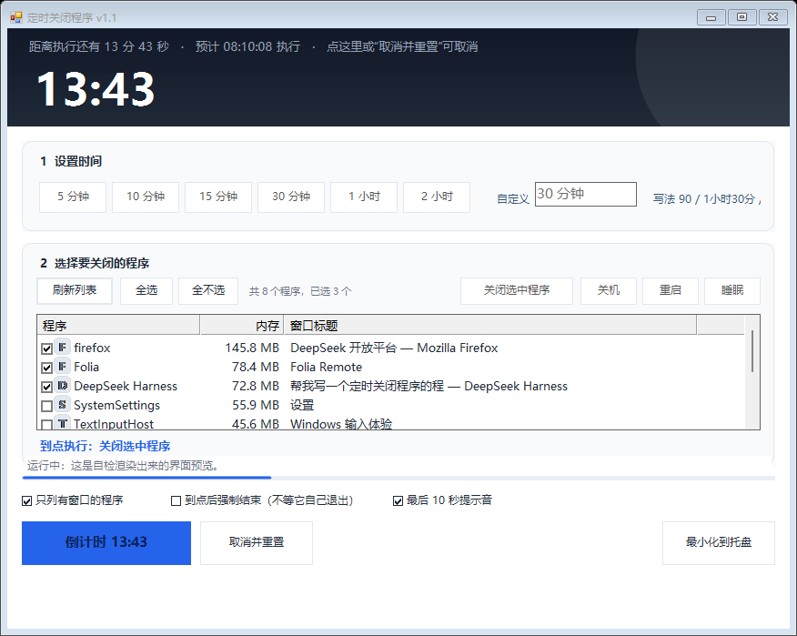
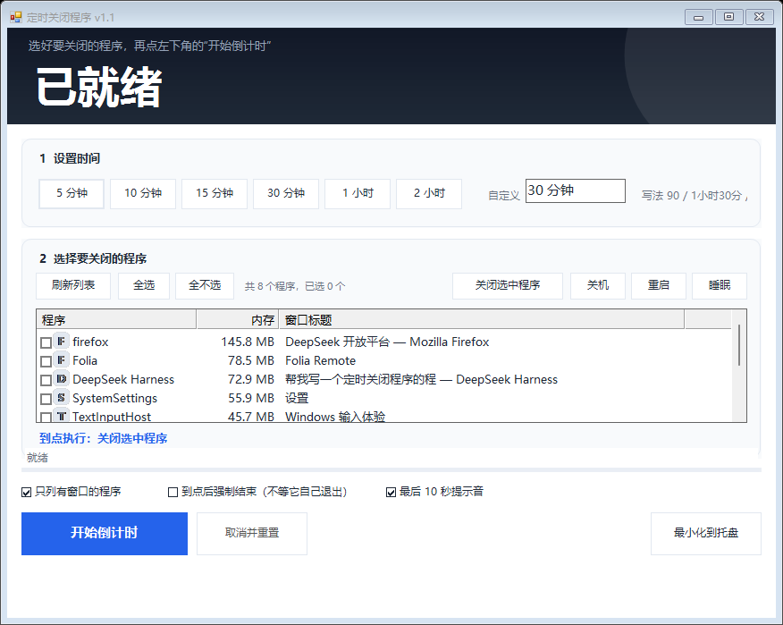

# 定时关闭程序 (Close Timer)

Windows 上的绿色小工具：**定好时间，到点自动关闭指定的程序**（也可以关机 / 重启 / 睡眠 / 锁定屏幕）。

单文件 exe，不写注册表、不需要安装 Python 或任何第三方运行库，只用系统自带的 .NET Framework 4.x
（Windows 10 1607 及以后、Windows 11 都自带）。

**下载**：[最新版本 Release](https://github.com/cheng777696/close-timer/releases/latest) → 下载 `CloseTimer-v1.1.exe`，双击即用。
也可以下载源码后运行 `编译.bat` 自己生成。





---

## 功能

- **定时关闭程序**：倒计时结束自动关闭选中的程序；支持多选，也可以按进程名批量关闭同类进程（如浏览器全部子进程）
- **系统操作**：倒计时结束后可以选择 `关机` / `重启` / `睡眠` / `锁定屏幕`
- **两种关闭方式**：
  - 默认「优雅关闭」——等价于点窗口右上角的 ×，程序有机会保存数据
  - 勾选「到点后强制结束」——1.5 秒内没自己退出就直接结束进程
- **随时可取消**：倒计时期间点「取消并重置」、点顶部大号数字、或托盘菜单取消
- **防误操作**：最后 30 秒窗口自动弹回最前，最后 10 秒有提示音；倒计时期间请求系统不要自动睡眠
- **托盘常驻**：点 × 最小化到托盘继续倒计时，托盘图标提示剩余时间
- **命令行模式**：带 `--time` 参数运行时不弹界面，适合放进 Windows 计划任务

## 使用方法

### 图形界面

1. 双击 `定时关闭程序.exe`（或 `启动.bat`）
2. **① 设置时间**：点 `5 分钟 / 10 分钟 / …` 快选，或自己填
   支持的写法：`90`（=90 分钟）、`90分钟`、`1小时30分`、`01:30:00`、`45秒`、`1天`
3. **② 选择要关闭的程序**：在列表里勾选（按内存占用排序，带程序图标与窗口标题）
   右上四个按钮决定「到点做什么」：`关闭选中程序` / `关机` / `重启` / `睡眠`
4. 点左下角 **`开始倒计时`**

### 命令行

```
定时关闭程序.exe --list                                            列出当前有窗口的程序
定时关闭程序.exe --time 30分钟 --process chrome,notepad --force      30 分钟后强制关掉这两个
定时关闭程序.exe --time 2小时 --action shutdown --force             2 小时后关机
定时关闭程序.exe --time "45 秒" --process notepad --log 日志.txt      45 秒后关记事本，并写日志
定时关闭程序.exe --help                                           显示全部参数
```

| 参数 | 说明 |
| --- | --- |
| `--time <时间>` | 必填。`5` / `5分钟` / `1小时30分` / `01:30:00`（纯数字按**分钟**算） |
| `--process <名字>` | 要关闭的进程名（不带 `.exe`），多个用逗号分隔 |
| `--action <动作>` | `close`（默认）/ `shutdown` / `restart` / `sleep` / `hibernate` / `lock` |
| `--force` | 到点直接强制结束，不等程序自己退出 |
| `--log <文件>` | 把过程写进日志文件 |
| `--list` | 只列出有窗口的程序 |
| `--gui` | 强制打开图形界面 |
| `--help` | 显示帮助 |

倒计时期间按 `Ctrl+C` 可随时取消，退出码 130 表示被取消。

---

## 编译

不需要 Visual Studio，用系统自带的 C# 编译器即可：

```
编译.bat
```

等价于：

```
%WINDIR%\Microsoft.NET\Framework64\v4.0.30319\csc.exe /nologo /target:winexe /platform:anycpu ^
    /optimize+ /utf8output /out:定时关闭程序.exe ^
    /reference:System.dll /reference:System.Core.dll /reference:System.Drawing.dll ^
    /reference:System.Windows.Forms.dll ^
    src\App.cs src\ConsoleRunner.cs src\MainForm.cs src\Program.cs src\SelfTest.cs
```

> `/utf8output` 不能省：源码是 UTF-8 无 BOM，缺了它编译器会按系统 ANSI 解读，中文字符串会损坏。

## 源码结构

| 文件 | 职责 |
| --- | --- |
| `src\App.cs` | 进程枚举、关闭逻辑（`WM_CLOSE` / 强制结束）、电源操作、时间解析 |
| `src\MainForm.cs` | 图形界面（自绘卡片 / 按钮 / 进度条 / 托盘图标） |
| `src\ConsoleRunner.cs` | 命令行模式 |
| `src\Program.cs` | 入口与参数解析 |
| `src\SelfTest.cs` | 自检（47 项，含离线界面渲染校验） |

## 自检

程序内置自检，不弹任何窗口：

```
定时关闭程序.exe --selftest --log 自检报告.txt
```

覆盖时间解析、进程枚举、界面排版与渲染（把窗口渲染成 PNG 后做像素取样）、倒计时精度等 47 项。
另外两个排查用参数：

- `--trace <文件>`：记录启动每一步
- `--shot <文件>`：打开界面 3 秒后自动截图

## 兼容性

- Windows 10 1607+ / Windows 11（需要 .NET Framework 4.x，系统自带）
- 也可以从源码编译后运行在 Windows 7 SP1 + .NET Framework 4.x 上（未实测）
- 32/64 位均可（`AnyCPU`）
- 关闭以管理员身份运行的程序时，本程序也需要以管理员身份运行

## 已知限制

- 倒计时是按真实时间计算的：期间电脑睡眠则不会执行，醒来后立即执行
- 关闭「无窗口」的后台进程只能用强制结束（没有窗口可发关闭消息）

## 许可

[MIT](LICENSE)
